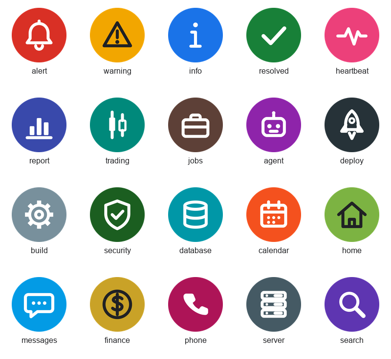

# Chat-room avatars

Circular avatars for Google Chat incoming webhooks and Chat apps. Every app
registered with the gateway can pick one, so a shared space reads at a glance.

## Using one

In the Chat space: **Apps & integrations → Webhooks → Add webhook**, then paste
the PNG URL below into **Avatar URL**. The name and avatar are fixed when the
webhook is created; changing them later means a new webhook (see
`docs/registering-an-app.md`).

URLs serve from `main` of this public repository; they work once this
directory is merged.

| | Name | Use for | Avatar URL |
|---|---|---|---|
|  | Alert | Loud lane: things that need action now | `https://raw.githubusercontent.com/mmackelprang/chat-gateway/main/assets/avatars/png/alert.png` |
|  | Warning | Degraded, watch it | `https://raw.githubusercontent.com/mmackelprang/chat-gateway/main/assets/avatars/png/warning.png` |
|  | Info | Quiet lane: status, digests, no action | `https://raw.githubusercontent.com/mmackelprang/chat-gateway/main/assets/avatars/png/info.png` |
|  | Resolved | All-clear threads and closed incidents | `https://raw.githubusercontent.com/mmackelprang/chat-gateway/main/assets/avatars/png/resolved.png` |
|  | Heartbeat | Dead-man checks and liveness | `https://raw.githubusercontent.com/mmackelprang/chat-gateway/main/assets/avatars/png/heartbeat.png` |
|  | Report | Scheduled reports and summaries | `https://raw.githubusercontent.com/mmackelprang/chat-gateway/main/assets/avatars/png/report.png` |
|  | Trading | Markets, positions, fills | `https://raw.githubusercontent.com/mmackelprang/chat-gateway/main/assets/avatars/png/trading.png` |
|  | Jobs | Job search, applications, careers | `https://raw.githubusercontent.com/mmackelprang/chat-gateway/main/assets/avatars/png/jobs.png` |
|  | Agent | AI agents and automated assistants | `https://raw.githubusercontent.com/mmackelprang/chat-gateway/main/assets/avatars/png/agent.png` |
|  | Deploy | Releases, rollouts, deploys | `https://raw.githubusercontent.com/mmackelprang/chat-gateway/main/assets/avatars/png/deploy.png` |
|  | Build | CI, builds, jobs and pipelines | `https://raw.githubusercontent.com/mmackelprang/chat-gateway/main/assets/avatars/png/build.png` |
|  | Security | Auth, access, secrets, audits | `https://raw.githubusercontent.com/mmackelprang/chat-gateway/main/assets/avatars/png/security.png` |
|  | Database | Data, storage, backups | `https://raw.githubusercontent.com/mmackelprang/chat-gateway/main/assets/avatars/png/database.png` |
|  | Calendar | Schedules, reminders, due dates | `https://raw.githubusercontent.com/mmackelprang/chat-gateway/main/assets/avatars/png/calendar.png` |
|  | Home | Family, household, home automation | `https://raw.githubusercontent.com/mmackelprang/chat-gateway/main/assets/avatars/png/home.png` |
|  | Messages | Conversations, inbound replies, chat bridges | `https://raw.githubusercontent.com/mmackelprang/chat-gateway/main/assets/avatars/png/messages.png` |
|  | Finance | Money, billing, budgets, P&L | `https://raw.githubusercontent.com/mmackelprang/chat-gateway/main/assets/avatars/png/finance.png` |
|  | Phone | Telephony, calls, voicemail | `https://raw.githubusercontent.com/mmackelprang/chat-gateway/main/assets/avatars/png/phone.png` |
|  | Server | Infrastructure, hosts, homelab | `https://raw.githubusercontent.com/mmackelprang/chat-gateway/main/assets/avatars/png/server.png` |
|  | Search | Research, monitoring, discovery | `https://raw.githubusercontent.com/mmackelprang/chat-gateway/main/assets/avatars/png/search.png` |

## Changing or adding one

Edit the `ICONS` table in `build.py` and run `python assets/avatars/build.py`.
It rewrites `svg/`, `png/`, `preview.png` and this README. It needs PyMuPDF
and Pillow, which are build-time tools only. Keep glyphs within about 70px of
the centre, because Chat crops avatars to a circle.
